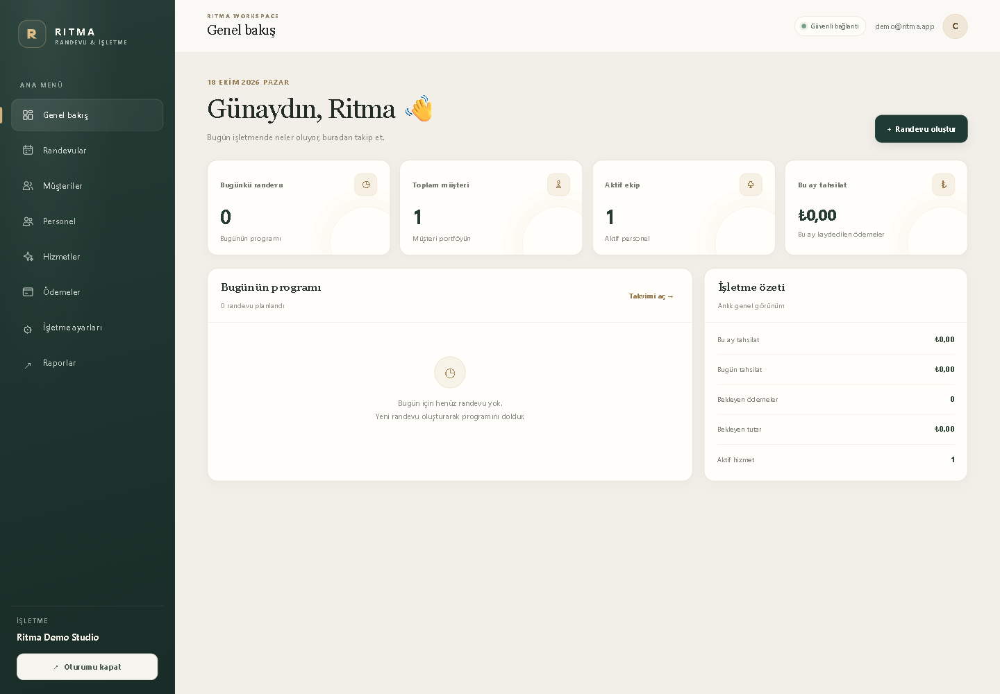
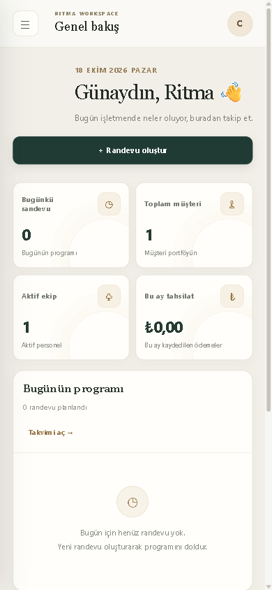

<div align="center">


# Ritma

### Randevularınızı yönetin. İşletmenizin ritmini yakalayın.

Ritma; randevuyla çalışan küçük işletmelerin takvimini, müşterilerini, ekibini, hizmetlerini ve tahsilat takibini tek bir sade çalışma alanında toplar.

[Özellikler](#-özellikler) · [Ekran görüntüleri](#-ekran-görüntüleri) · [Kurulum](#-kurulum) · [Mevcut kapsam](#-mevcut-kapsam)


</div>

---

## ✨ Özellikler

- **Randevu yönetimi:** Takvim veya liste görünümü, durum güncelleme, tarih filtreleri ve çakışma kontrolü.
- **Online randevu sayfası:** Müşteriler hizmet ve uygun zaman seçerek talep oluşturabilir; işletme talepleri panelinden yönetir.
- **Müşteri kayıtları:** Müşteri arama ile randevu ve ödeme geçmişini tek yerde görüntüleme.
- **Ekip ve hizmetler:** Personel, hizmet, çalışma saatleri ve işletme bilgilerini yönetme.
- **Tahsilat takibi:** Ödeme durumlarını kaydetme, tarih aralığına göre raporlama ve CSV dışa aktarma.
- **Günlük kolaylıklar:** WhatsApp ve e-posta mesaj taslakları, takvime eklenebilir randevu dosyaları ve iptal bağlantıları.
- **Güvenli API:** JWT kimlik doğrulama, işletme kapsamlı veri erişimi, istek doğrulama ve giriş/online randevu uçlarında hız sınırlama.
- **Duyarlı arayüz:** Masaüstü ve mobil ekranlarda kullanılabilen yönetim paneli.

## 🖥️ Ekran görüntüleri

### Yönetim paneli · Masaüstü



### Yönetim paneli · Mobil



## 🚀 Kurulum

### Gereksinimler

- [.NET 10 SDK](https://dotnet.microsoft.com/download/dotnet/10.0)
- SQL Server veya SQL Server LocalDB

### 1. Projeyi hazırlayın

```powershell
git clone https://github.com/Keremcanatass-58/ritma.git
cd ritma
Copy-Item appsettings.example.json appsettings.json
```

> Depoda `appsettings.json` bulunmaz. Veritabanı ve JWT ayarlarınızı yerel ortamınızda yapılandırın; gizli bilgileri GitHub'a eklemeyin.

### 2. Gizli ayarları tanımlayın

```powershell
dotnet user-secrets init
dotnet user-secrets set "ConnectionStrings:DefaultConnection" "<SQL Server bağlantı dizeniz>"
dotnet user-secrets set "Jwt:Key" "<en az 32 karakterlik rastgele bir anahtar>"
dotnet user-secrets set "Jwt:Issuer" "Ritma"
dotnet user-secrets set "Jwt:Audience" "Ritma"
```

### 3. Veritabanını hazırlayıp uygulamayı başlatın

```powershell
dotnet tool install --global dotnet-ef
dotnet ef database update
dotnet run --project Ritma.Api.csproj --launch-profile http
```

Uygulamayı **http://localhost:5019** adresinde açın. İlk işletme çalışma alanını oluşturmak için kayıt ekranından bir sahip hesabı açın. Geliştirme ortamındaki OpenAPI belgesi **http://localhost:5019/openapi/v1.json** adresindedir.

## 🧭 Mevcut kapsam

Ritma, randevu ve işletme yönetimi için çalışan bir uygulama/API temelidir. Kapsamı doğru değerlendirebilmeniz için mevcut durumu açıkça belirtiyoruz:

- Ödemeler kaydedilip raporlanabilir; **kartla ödeme alma veya ödeme sağlayıcısı bağlantısı henüz yoktur.**
- WhatsApp ve e-posta kısayolları **gönderime hazır taslak açar**; otomatik gönderim ve SMS sağlayıcısı bağlantısı henüz yoktur.
- İnternete açık kullanım için barındırma, alan adı, üretim veritabanı ve ilgili sağlayıcı hesapları ayrıca yapılandırılmalıdır.

## 🧰 Teknoloji

- ASP.NET Core Web API · .NET 10
- SQL Server ve Entity Framework Core
- JWT kimlik doğrulama
- Duyarlı HTML/CSS/JavaScript arayüzü

## 📄 Lisans

Bu depoda henüz bir açık kaynak lisans dosyası bulunmuyor. Lisans eklenene kadar kodun yeniden kullanım ve dağıtım hakları tanımlanmış değildir.

---

<div align="center">
Ritma · İşletmenizin günlük akışı için tek bir çalışma alanı.
</div>
